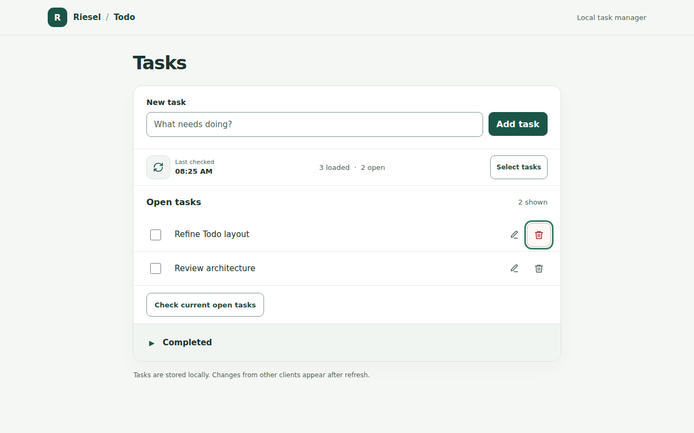
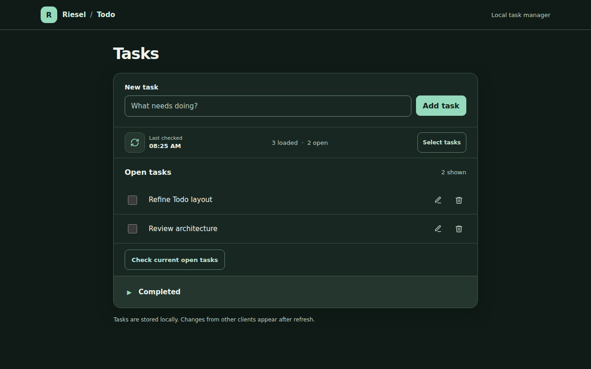
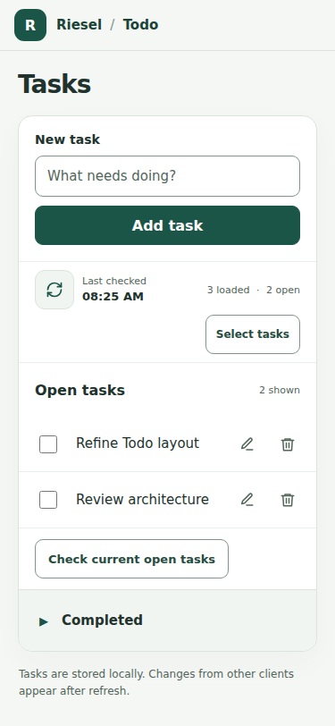
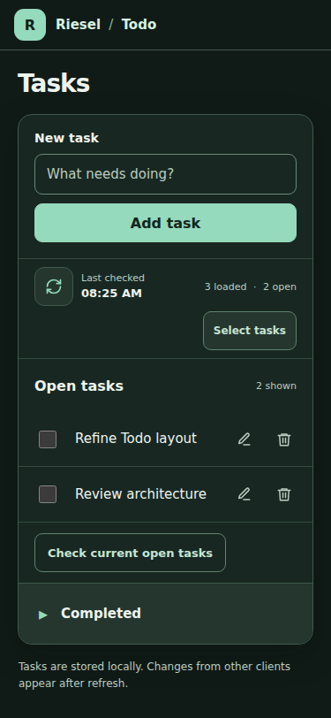
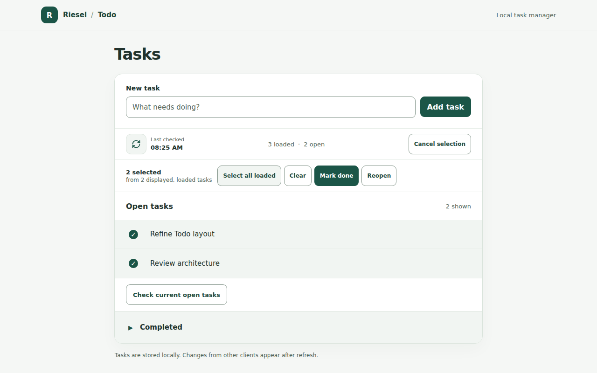
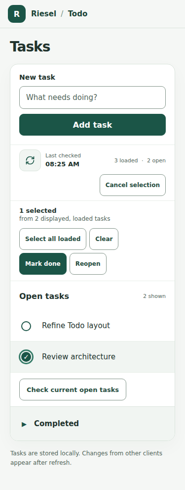
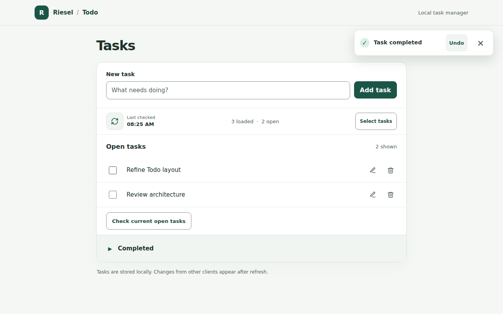
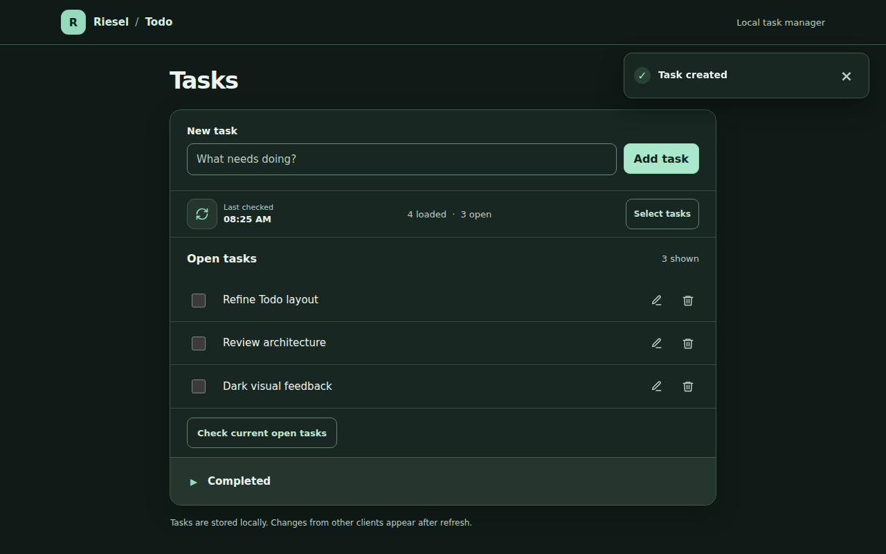
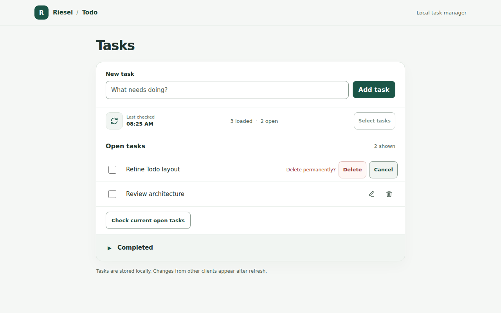
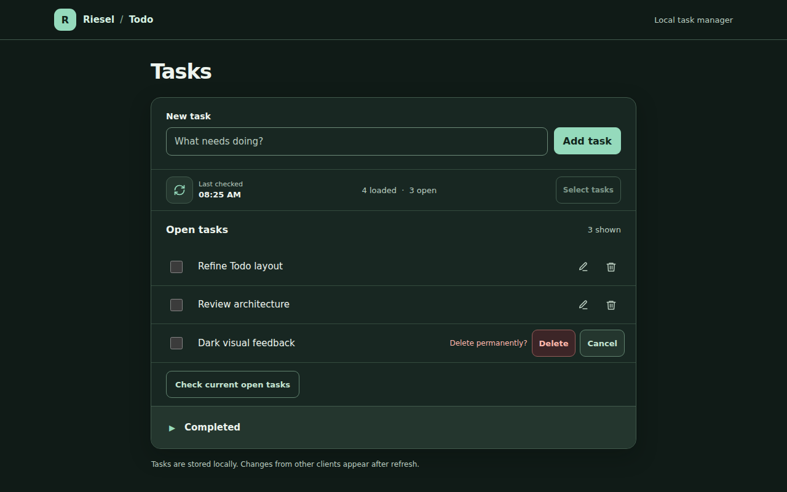

# Todo R2 — verified visual reference

These are **real, unmodified Playwright PNG screenshots** from the Riesel Todo **Rust/SQLite application**, not stock images, illustrations, design mockups, or screenshots of another product. They are a **dated visual baseline**, not a guarantee that a later commit looks identical.

- **Captured application revision:** [`0adcfa2e9d8a3fb2b3386d7f324140ed4e681b28`](https://github.com/aschenrot/riesel/commit/0adcfa2e9d8a3fb2b3386d7f324140ed4e681b28).
- **Evidence:** [Todo Web workflow #45002649135](https://github.com/aschenrot/riesel/actions/runs/45002649135), successful on 22 November 2026; artifact **`todo-r2-visual-review`**, ID `14746147581`.
- **Fixture:** deterministic task data, local same-origin `todo_http` and linked SQLite, automated Chromium E2E captures in [`e2e/tasks.spec.ts`](../../../examples/todo/web/e2e/tasks.spec.ts). The displayed task titles and clock are test data, not live user content or a continuously updated screenshot.
- **Storage:** the ten original PNGs are committed under [`screenshots/`](screenshots/) to avoid depending on GitHub Actions' finite artifact retention. Screenshot content was not generated, redrawn, cropped, or retouched.

## Desktop — default list

| System light | System dark |
| --- | --- |
|  |  |

The **Open** section appears first; **Completed** starts collapsed. The refresh icon represents a **manual check**, not continuous synchronization. Labels such as `3 loaded`, `2 open`, and `2 shown` describe loaded results, **not global database totals**. The current first Query profile scans bounded live records in UUID order; it is not chronological and does not promise an atomic snapshot.

## Responsive layout — mobile

| System light, 375 px | System dark, 375 px |
| --- | --- |
|  |  |

These captures show browser viewport behavior. They do not establish a native mobile application, PWA installation or independently selectable Dark mode. The browser currently **follows the OS/browser theme**; a persisted System/Light/Dark override remains [specification #106](https://github.com/aschenrot/riesel/issues/106).

## Selection and batch completion

| Desktop selection | Mobile selection |
| --- | --- |
|  |  |

Selection and Shift-range actions operate on **visible, loaded tasks**, not every matching database record. Batch completion/reopening consists of individually revision-checked writes; partial failures are reported without implying an atomic batch. The normal completion checkbox and the selection-mode checkbox have different purposes.

## Toast feedback and Undo

| System light | System dark |
| --- | --- |
|  |  |

The short-lived Undo action is for **confirmed title/completion changes**, using the observed post-write revision. It cannot overwrite a newer independent edit. No persistent command history or deletion Undo is implied.

## Delete confirmation — important current limitation

| System light | System dark |
| --- | --- |
|  |  |

**Deletion here is permanent.** Although the direct button uses a trash-can icon, it does **not** currently move the task to a recoverable Trash. Durable Trash, Restore and safe purge require the separate [#119 design and implementation](https://github.com/aschenrot/riesel/issues/119); do not use these screenshots as evidence that those features have shipped.

## Regenerate and review this baseline

From the repository root, with the pinned Rust toolchain, Node.js 22.12+ and Playwright-compatible Chromium available:

```sh
cd examples/todo/web
npm ci
npx playwright install --with-deps --only-shell chromium
npm run build
cd ../../..
cargo build --locked -p todo --features http,e2e-fixture --bin todo_http --bin todo_seed_status
cd examples/todo/web
npm run test:e2e
```

The test runner [`e2e/run.mjs`](../../../examples/todo/web/e2e/run.mjs) starts isolated real Rust/SQLite hosts with OS-assigned ports, executes Playwright, and writes captures to `examples/todo/web/test-results/visual-review/`. The 10,000-record sparse Query test uses a **separate** fixture and output directory so that it cannot replace the visual-review captures. CI uploads `todo-r2-visual-review` as an artifact with **14-day retention**, so the repository copies serve as the durable reviewed baseline.

**Updating these assets:** regenerate them against a known application commit and real backend, inspect desktop/mobile/light/dark/selection/feedback/destructive states, review changed pixels and user-visible behavior, then commit updated captures and revise the provenance above in the *same documentation PR*. Never silently replace an old baseline with generated mockups or unsourced screenshots. CI tests are supporting evidence; human visual/accessibility review remains necessary.

## Further documentation

- [Todo product definition](todo.md) — supported product scope, R0/R1/R2.
- [Local browser and HTTP contract](http-local-browser-contract.md) — security, status Query and mutation semantics.
- [Todo Rust README](../../../examples/todo/README.md) — run the reference app, CLI, or local HTTP backend.
- [Browser development and E2E guide](../../../examples/todo/web/README.md) — frontend development, tests and current limitations.
